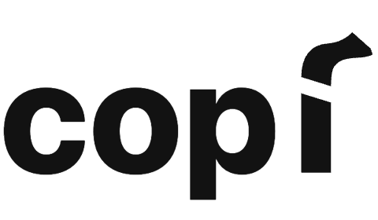
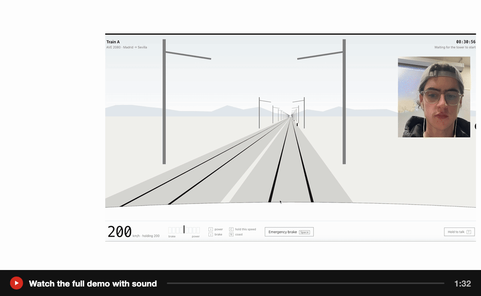
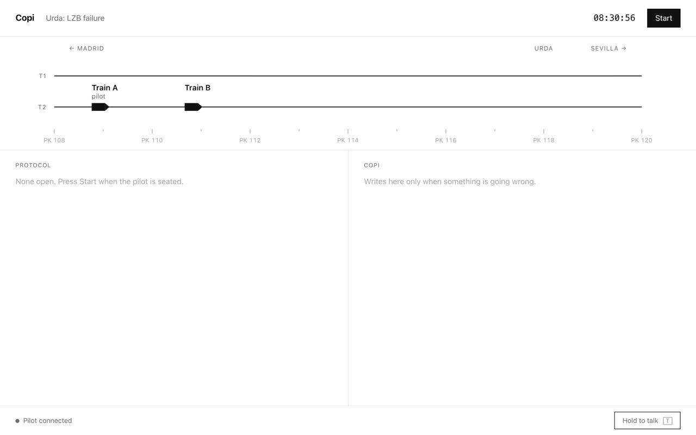
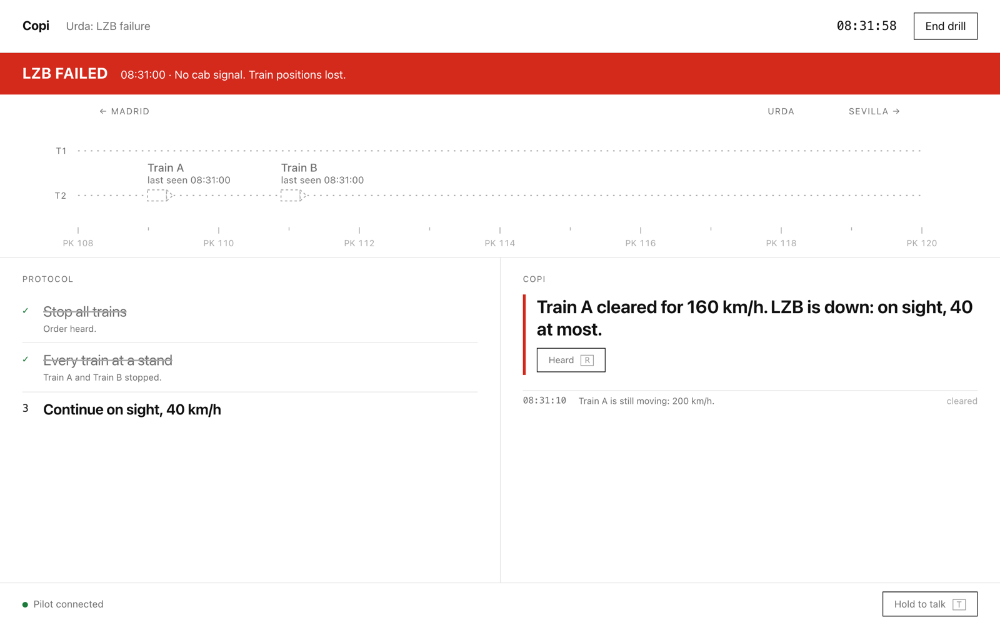
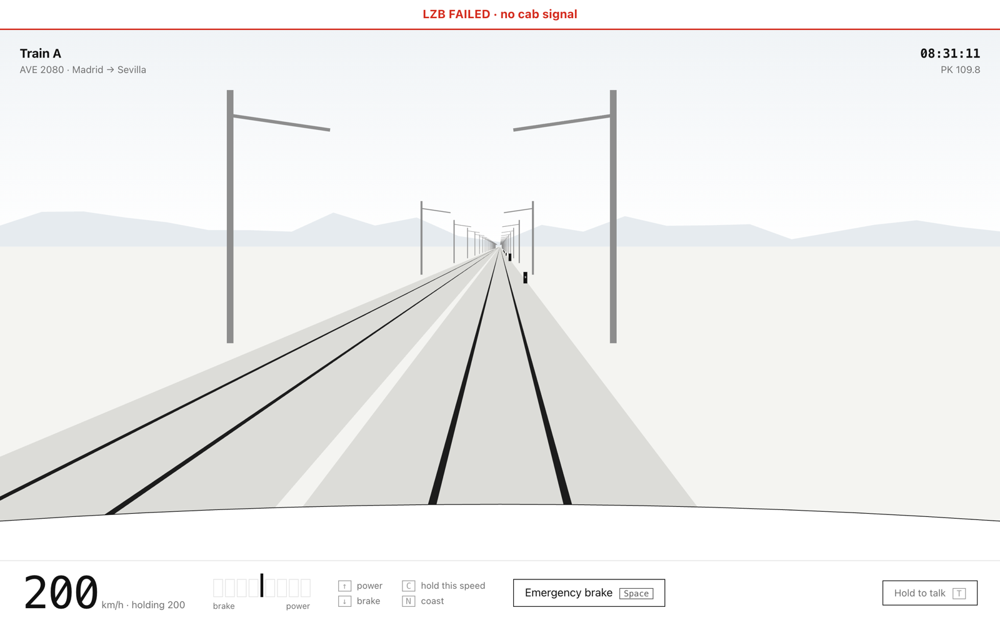
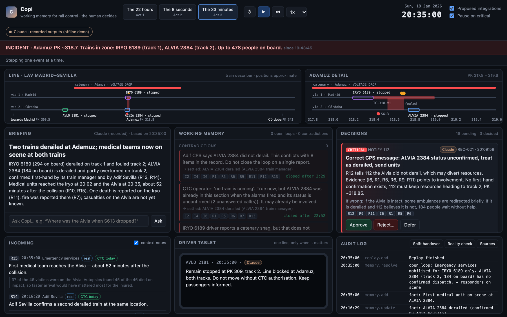
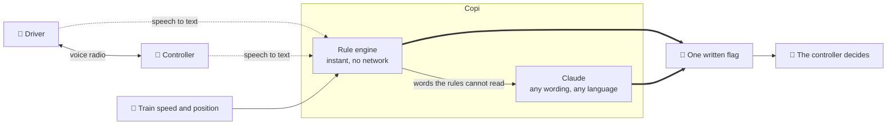
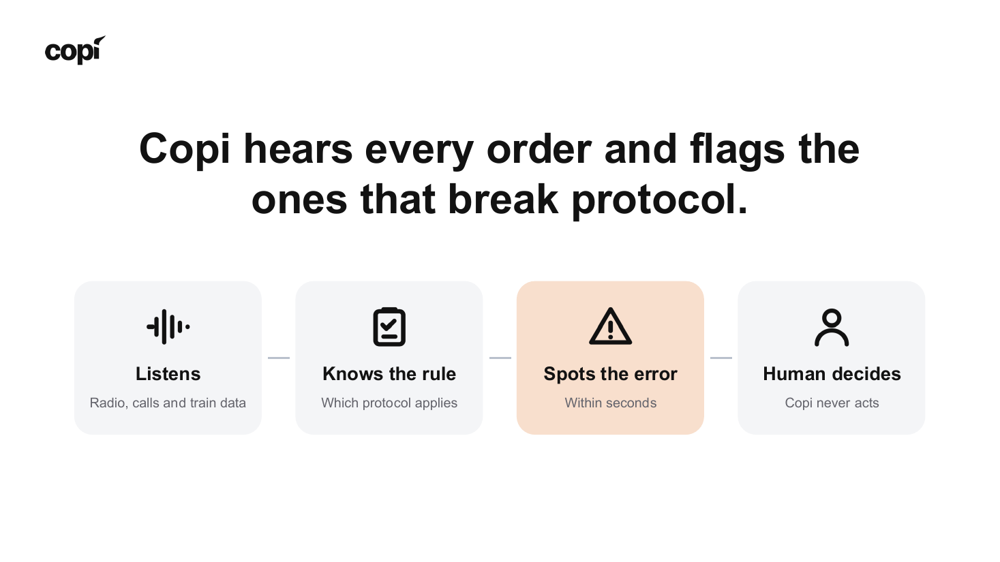

<div align="center">

<picture>
  <source media="(prefers-color-scheme: dark)" srcset="docs/img/logo-dark.png">
  
</picture>

### A second pair of eyes for rail control rooms

Copi listens to the controller and the driver, checks every order against the protocol,<br>
and flags the controller when the two don't match. **The human decides.**

<p>
  
  
  
  <a href="https://github.com/TomyCabrer/cacaton/releases/tag/lzb-adapter-v1"></a>
  
  
  
</p>

**[▶ Watch the demo](https://github.com/user-attachments/assets/cf55fdb6-f108-46ef-9a5b-277d937b7882)** · **[🌐 copi115.com](https://www.copi115.com/)** · **[📑 Pitch deck](Copi_presentation.pdf)** · [Try it](#-try-it-in-60-seconds) · [How it works](#-how-it-works) · [Track 03](#-track-03-voice-vision--generative-media) · [Adaption](#-how-we-used-adaption) · [Business](#-the-business) · [What's next](#-where-copi-goes-next) · [Team](#-team)

<br>

<a href="https://github.com/user-attachments/assets/cf55fdb6-f108-46ef-9a5b-277d937b7882"></a><br>
<sub>Nine frames from our demo video. One person drives, the other controls, and Copi flags two mistakes.<br>
<b><a href="https://github.com/user-attachments/assets/cf55fdb6-f108-46ef-9a5b-277d937b7882">▶ Watch the full demo with sound</a></b> (1 min 32 s). The current team video is linked in <a href="video/">video/</a>.</sub>

</div>

<br>

## 🚨 The problem

> **28 October 2026, Urda (Toledo).** The cab signalling (LZB) drops on the Madrid–Sevilla high-speed line. One train stops and cannot restart. The control centre clears the train behind it for normal running, when the rule is to continue on sight. About 17 minutes later the two collide.

Control rooms have panels, alarms and supervisors. None of them checks a **spoken order** against the rule that applies at that moment. Copi does.

<sub>Reconstructed from preliminary press reports. The investigation is still open. Timeline and sources: <a href="copi-neat/docs/urda.md">copi-neat/docs/urda.md</a>.</sub>

## 💡 What Copi does

| 👂 Listens | 📖 Checks | 🚩 Flags |
|---|---|---|
| To the radio between driver and controller, in English or Spanish | Each order against the protocol for what is happening on the line | One line on the controller's screen, and only when something is wrong |

It runs in the control centre and needs nothing installed on the train. It is advisory: Copi cannot touch the railway.

## ⚡ Try it in 60 seconds

**No API key, no account, no microphone.** You need Python 3.10 or later.

```bash
git clone https://github.com/TomyCabrer/cacaton.git
cd cacaton/copi-neat
./run.sh
```

The first run sets up its own environment. Then open:

| | |
|---|---|
| 🗼 **Control tower** | http://localhost:8000/drill/control |
| 🚄 **Pilot** (a second window) | http://localhost:8000/drill/driver |

**Play the drill**

1. In the pilot window, click **Take the seat**. In the tower window, press **Start**.
2. Four seconds in, LZB fails. Do nothing, and ten seconds later Copi writes *Train A is still moving: 200 km/h.*
3. Now give the tower's orders. With no microphone set up, speak for the tower from a second terminal:

```bash
tower() { curl -s localhost:8000/api/drill/copi/heard -H 'content-type: application/json' -d "{\"role\":\"control\",\"text\":\"$1\"}"; }

tower "All trains stop"             # then brake in the pilot window with Space
tower "Train A, continue at 160"    # the Urda mistake. Watch Copi flag it
tower "Continue on sight at 40"     # the right order. Space releases the brake, ↑ drives on: keep to 40
```

This is what the tower's screen shows:



### 🔑 Bring your own keys

**This repo ships no API keys, and nobody shares one.** Each person runs Copi on their own LLM key. Until you add a key, Copi replays Claude outputs we recorded, which is why the steps above need no account. To run it live, add your own keys. They stay on your machine in a git-ignored file.

```bash
cp .env.example .env
```

| To get | Put in `copi-neat/.env` | Where to get it |
|---|---|---|
| Live Claude | `ANTHROPIC_API_KEY` | [console.anthropic.com](https://console.anthropic.com) |
| Voice radio between pilot and tower | `LIVEKIT_URL`, `LIVEKIT_API_KEY`, `LIVEKIT_API_SECRET` | [cloud.livekit.io](https://cloud.livekit.io) |
| A different Claude model for the replay | `MEMORIA_MODEL` | optional |

With LiveKit keys you can run the full drill on two laptops, by voice:

```bash
./drill.sh --tunnel     # the tower runs here; the pilot's link appears on the tower's screen
```

That needs [`uv`](https://docs.astral.sh/uv/) and `cloudflared` (`brew install cloudflared`).

## 🎮 The drill

One person is the pilot and sees only the track. The other is the control tower and sees the line but not the track. They have nothing but their voices.

| 🗼 Control tower | 🚄 Pilot |
|---|---|
|  |  |

Copi stays silent unless something is going wrong:

| Copi writes | When |
|---|---|
| *Train A is still moving: 200 km/h.* | 10 s after the failure, the train is not braking |
| *Train A cleared for 200 km/h. First step: stop all trains.* | the tower lets a train go on before it has stopped |
| *Train A cleared for 160 km/h. LZB is down: on sight, 40 at most.* | the tower allows more than 40, in any wording or language |
| *Train A at 66 km/h. On sight is 40.* | the train is too fast after the stop |
| *Train B is stopped 460 m ahead of Train A.* | the train is running out of room |

<details>
<summary><b>🎬 Also in the box: the Adamuz replay console</b></summary>

<br>

A second demo replays the real timeline of the Adamuz collision (18 January 2026) in three acts. Copi correlates weak signals in the 22 hours before, stays out of the way in the 8 seconds that belong to automatic protection, and in the 33 minutes after it fuses alarms, tracks unanswered calls and flags contradictions. Every recommendation waits for **Approve**, **Reject** or **Defer**.



</details>

## 🧠 How it works

The protocol, with Copi in the loop:


Inside Copi:



- **Advisory only.** Copi proposes. A person approves, rejects or defers.
- **No language model where seconds count.** Rules do the fast work with no network. Claude handles what the rules cannot read.
- **Evidence or nothing.** Every flag cites the events behind it.
- **Quiet by default.** One line when something is wrong. Otherwise, *Nothing to flag*.

Stack: FastAPI, plain JavaScript with no build step, Claude, LiveKit. More in [`copi-neat/README.md`](copi-neat/README.md).

## 🎤 Track 03: Voice, Vision & Generative Media

Copi is a voice product. People talk, Copi listens, and the only thing anyone has to learn is to keep talking the way they already do.

| | How Copi uses it |
|---|---|
| **Voice in** | Pilot and tower talk over a LiveKit radio. Speech-to-text streams every line to Copi, in English or Spanish. |
| **Understanding** | Rules read the common orders instantly. Claude reads everything else, however it is phrased. |
| **Voice out** | Copi can speak its flags to the tower, and stops the moment the tower says "heard". |
| **Generative media** | An optional Synthesia avatar gives Copi a face that lip-syncs the same audio. |

## 🔬 How we used Adaption

We used **Adaption AutoScientist** to turn a small open model into a protocol checker. It reads a control log from an LZB failure and answers with a verdict, the rule broken, the step, and a reason. The goal is a model that knows the protocol by heart, with no rule book in its prompt, and small enough to run on one GPU.


The whole pipeline is a few short scripts on the `adaption` Python SDK:

```python
ds  = client.datasets.upload_file("train.jsonl", processing_mode="raw")
run = client.autoscientist.create(dataset_id=ds.dataset_id, model="Qwen/Qwen3.5-4B",
                                  training_method="instruction", data_format="instruction",
                                  max_iterations=2)
with client.autoscientist.with_streaming_response.download(run.id) as r:
    r.stream_to_file("best-checkpoint.tgz")        # the LoRA adapter
```

**What we got**

| | Untuned Qwen3.5-4B, rules in the prompt | Fine-tuned on Adaption |
|---|---|---|
| Verdict accuracy | `██████░░░░` 60% | `█████████░` **86%** |
| Verdict and rule both right | `█░░░░░░░░░` 11% | `█████████░` **86%** |
| False alarms on 97 compliant logs | 80 | **23** |

**What Adaption did for us**

- **No training code and no GPU of our own.** One `create` call, 43 minutes, done.
- **It searched the settings itself.** AutoScientist chose the LoRA rank, epochs and learning rate, and changed them between its two iterations.
- **Open weights.** The result is a standard LoRA adapter, so we scored it ourselves with `transformers` and `peft` on a free Colab T4.
- **We gave feedback.** Seven concrete suggestions for the Adaption team, from hosting tuned checkpoints to label-accuracy evals.

**📦 The model is published.** The trained adapter is in the [`lzb-adapter-v1` release](https://github.com/TomyCabrer/cacaton/releases/tag/lzb-adapter-v1): a LoRA for `Qwen/Qwen3.5-4B`, 160 MB to download. [`finetune/README.md`](finetune/README.md) shows how to score it on a GPU (a free Colab T4 works).

Next step: wire the model into the drill, where Claude does this job today.

📄 [Results](finetune/REPORT.md) · [Our Adaption write-up and feedback](finetune/ADAPTION.md) · [The six protocol rules](finetune/PROTOCOL.md) · [Reproduce it](finetune/README.md)

## 📑 The pitch deck

<div align="center">

<a href="Copi_presentation.pdf"></a><br>
<sub><b><a href="Copi_presentation.pdf">Open the pitch deck</a></b> (PDF, 8 slides).</sub>

</div>

The slides we present with: what happened at Urda, the check nobody makes, how Copi makes it, who has to buy it, what it costs, and the team.

## 💼 The business

| 40,000 € | ~240 | ~10 M€ | ~125 M€ |
|:---:|:---:|:---:|:---:|
| per control position, per year | positions in ADIF's 19 control centres | a year in Spain | a year in Europe |

- **Customer:** ADIF, starting with a paid pilot in one control centre. Air traffic control comes next.
- **Why now:** Spain's rail safety plan of 3 November 2026 already asks for "an AI agent" to watch conversations between driver and controller. It has no supplier, cost or date yet.
- **In perspective:** Copi across all of Spain costs less per year than 5% of a single ERTMS contract.

Need, market, financials, feasibility, regulation and legal are in [`business/`](business/) (in Spanish). The figures are our own assumptions.

## 🔭 Where Copi goes next

Spanish rail is the first case. The method is the same anywhere a controller gives safety orders by voice: listen to the radio, check each order against the written protocol, flag the mismatch.

| 🌍 More countries | ✈️ Air traffic control | 🎓 Training |
|---|---|---|
| Every European network has control centres like ADIF's and relies on spoken orders when the signalling drops. By our estimate that is about 3,200 control positions. | The same problem: a controller, a radio and a protocol. The European project HAAWAII caught 82% of readback errors, with a 67% false-alarm rate. Precision is the hard part. | Degraded running is rare, so controllers and drivers get little practice at it. The drill in this repo is already a two-seat exercise, and Copi flags each mistake with the evidence behind it. |
| **What it takes:** each country's rulebook, and radio data in its language. Our model is still weaker in Spanish (78%) than in English (95%). ADIF is the reference, with the same safety case. | **What it takes:** aviation phraseology, and surveillance data in place of train data. Checking the voice against where the aircraft is should cut the false alarms. Customers such as ENAIRE, Spain's air navigation provider. We have not sized this market. | **What it takes:** more cases. The engine holds five, one per protocol. It runs on two laptops and touches nothing live, so it can start in a training centre before any control room. Each session also produces the spoken radio data the model lacks today. |

<sub>Figures and sources: <a href="business/02%20Mercado.md">business/02 Mercado.md</a> and <a href="finetune/REPORT.md">finetune/REPORT.md</a>.</sub>

## 📝 Honest notes

- The scenarios are rebuilt from press reports, and the Urda investigation is still open.
- The model was tested on synthetic logs, not real radio.
- Copi is a hackathon prototype, not a certified safety system.

## 👥 Team

| | Worked on | GitHub |
|---|---|---|
| **Tomy** | Platform: the drill and the replay console | @TomyCabrer |
| **Sobri** | Fine-tuned model and evaluation | @j-sobrino |
| **Jaime** | Business, market, regulation and legal | @jaimeramaa |
| **Juan** | Design, specification and the demo video | @juaninjr |

## 🔗 Links

[Copi website](https://www.copi115.com/) · [Pitch deck](Copi_presentation.pdf) · [Imperial AI Hack](https://imperialaihack.com/login) · [Adaption](https://adaptionlabs.ai) · [Discord](https://discord.gg/28XrgECKY) · [Event page](https://luma.com/c6zebxau)
